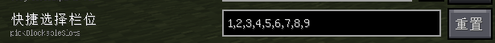

# Litematica Printer — Hana

**English** | [简体中文](README.zh-CN.md)

[](https://github.com/Yur1Ca/litematica-printer/actions/workflows/build.yml)
[](https://modrinth.com/mod/litematica-printer-hana)
[](https://github.com/Yur1Ca/litematica-printer/releases)
[](LICENSE.md)

Litematica Printer — Hana is a client-side Fabric mod that adds automated schematic building to Litematica. It restores a schematic by placing the correct blocks around the player and also provides filling, fluid removal, mining, bedrock breaking, inventory assistance, and related utilities.

This repository is an independently maintained continuation of earlier Litematica Printer forks, with a rewritten bedrock-breaking workflow, scanner and iterator improvements, and additional building features.

## Download and release channels

- [Modrinth](https://modrinth.com/mod/litematica-printer-hana) provides the multi-version Wrapper JAR and is recommended when launcher or Mod Menu update detection is desired.
- [GitHub Releases](https://github.com/Yur1Ca/litematica-printer/releases) also provides standalone JARs for individual Minecraft versions.
- Automated `devXXX` builds are published as **Alpha** versions.
- Manually created releases are published as **Beta** versions.
- There is currently no stable release channel.

## Supported Minecraft versions

- 1.18.2
- 1.19.4
- 1.20.1, 1.20.2, 1.20.4, and 1.20.6
- 1.21 through 1.21.11
- 26.1.x, 26.2 and 26.3

Versions older than 1.18.2 are not supported. Intermediate Minecraft versions may work when they are covered by the same compatibility range, but are not always built as separate JARs.

## Requirements

Required:

- [Fabric Loader](https://fabricmc.net/)
- [Fabric API](https://modrinth.com/mod/fabric-api)
- [MaLiLib](https://modrinth.com/mod/malilib)
- [Litematica](https://modrinth.com/mod/litematica)

Optional integrations:

- [Tweakeroo](https://modrinth.com/mod/tweakeroo)
- [Quick Shulker](https://github.com/MoRanpcy/quickshulker)
- [Take It Out](https://modrinth.com/mod/takeitout), on supported 1.21.x and 26.x versions
- [Chest Tracker](https://github.com/ponuing/ChestTracker), on versions with a matching upstream build

Dependency versions must match the Minecraft version being launched.

## Features

### Printing and performance

- Player-centered placement ordered by distance.
- Scanner caching and time-budgeted iteration for large schematic areas.
- Packet-based placement for faster operation without client-side ghost blocks.
- Placement progress and missing-material HUDs.
- Server-lag and round-trip-time safeguards for mixed-material printing.
- Safer handling for directional and state-sensitive blocks.

### Building tools

- Fill within the active schematic or selection area.
- Drain water and lava source blocks.
- Mine blocks within the selected area.
- Independent handling of extra blocks and wrong-state blocks.
- Bedrock-breaking mode with an allowlist.
- Waterlogged block placement and ice-breaking water placement.
- Replacement of dead coral in the schematic using live coral.

### Inventory integrations

- Container sync: bind **Sync Containers**, enable the master work switch, select an empty main-hand slot and point at a template chest, barrel or shulker box. Matching containers in the Litematica area selection are filled slot by slot; double chests count as one container. Move within normal interaction range of each target.
- Materials come from your inventory; surplus returns there. Missing items or storage space pauses the task; press the hotkey to retry after resolving it. Pressing the hotkey while running or disabling the master switch cancels after the current transfer settles. Main hand, armor, offhand and protected hotbar slots are excluded. Remote retrieval integrations are not required.
- If the server forcibly closes a container during transfer, synchronization waits for a full inventory confirmation before pausing. The server handles the carried stack; vanilla may drop items that cannot fit in your inventory.

- Quick Shulker material retrieval and ordered return.
- Take It Out remote material retrieval on supported versions.
- Chest Tracker retrieval from containers explicitly cached inside the active Litematica selection on supported versions.
- Material switching safeguards intended to prevent placement with the previous hotbar item.

The printer also contains special placement logic for many vanilla blocks, including stairs, doors, trapdoors, hoppers, chests, levers, redstone wire, vines, hanging plants, grindstones, crafters, flower clusters, and other directional blocks.

## Basic usage

1. Load a schematic in the world with Litematica.
2. Move within interaction range of the schematic blocks.
3. Press `Caps Lock` to enable the printer.
4. Adjust printer settings in the configuration screen when required by the server.

Most options include tooltips in the configuration interface. There is not yet an official full tutorial.

## Known unsupported content

Some content cannot currently be printed reliably and may be skipped or placed with an incorrect state:

- Skulls, signs, banners, and other blocks with unusually complex state or data handling.
- Cauldrons containing fluids.
- Entities such as item frames, armor stands, and paintings.
- Non-vanilla content unless it is explicitly supported.

If a vanilla block is placed incorrectly even at a conservative work interval, submit a [block support report](https://github.com/Yur1Ca/litematica-printer/issues/new/choose).

## Troubleshooting

### The printer does not work after being enabled

- Some anti-cheat systems reject the printer's silent rotation or placement interaction.
- A very short work interval can exceed a server's placement-rate limit. Increase the interval or try packet-based printing when the server supports it.
- Account or session state can occasionally interfere with interaction packets. Reconnecting the account or server may help.

### Blocks are placed with the wrong state

- Server anti-cheat or high latency may prevent the simulated rotation from being accepted.
- The work interval may be too short for the server to acknowledge material switching and placement.
- The block may require placement logic that is not implemented yet. Please include its block ID, target state, Minecraft version, printer version, and a reproducible example in the issue.

### Quick Shulker does not work

- The server must support opening shulker boxes from the inventory for the selected integration mode.
- The configured mode must match the mod or server behavior actually available.
- Litematica's `pickBlockableSlots` must contain usable hotbar slots and should not be filled entirely with shulker boxes.



## Support and contributing

- Use [GitHub Discussions](https://github.com/Yur1Ca/litematica-printer/discussions) for installation help, configuration questions, compatibility discussions, and general feedback.
- Use [GitHub Issues](https://github.com/Yur1Ca/litematica-printer/issues/new/choose) only for reproducible bugs, block support problems, and concrete feature requests.
- Search existing Issues and Discussions before opening a new report.
- Keep one independently reproducible problem per Issue and attach `latest.log`, crash reports, screenshots, or short recordings where relevant.

## Building

JDK 25 is recommended when building the complete multi-version Wrapper.

```bash
./gradlew :fabricWrapper:build
```

Build outputs:

- Multi-version Wrapper: `fabricWrapper/build/libs/`
- Standalone version JARs: `fabricWrapper/build/libs/jars/`

The first build downloads Minecraft and mod dependencies and may require a working connection to their Maven repositories.

## Acknowledgements

- [bunny_i](https://github.com/bunnyi116) for broad support and contributions to the project.
- [aleksilassila/litematica-printer](https://github.com/aleksilassila/litematica-printer) for the original project.
- [zhaixianyu/litematica-printer](https://github.com/zhaixianyu/litematica-printer) for earlier fixes and features.
- [MoRanpcy/quickshulker](https://github.com/MoRanpcy/quickshulker) for Quick Shulker integration.
- [bunnyi116/fabric-bedrock-miner](https://github.com/bunnyi116/fabric-bedrock-miner) for the bedrock-breaking foundation.
- Everyone who tests, reports issues, contributes code, or supports the project.

## License

This project is licensed under the [GNU Affero General Public License v3.0](LICENSE.md).
